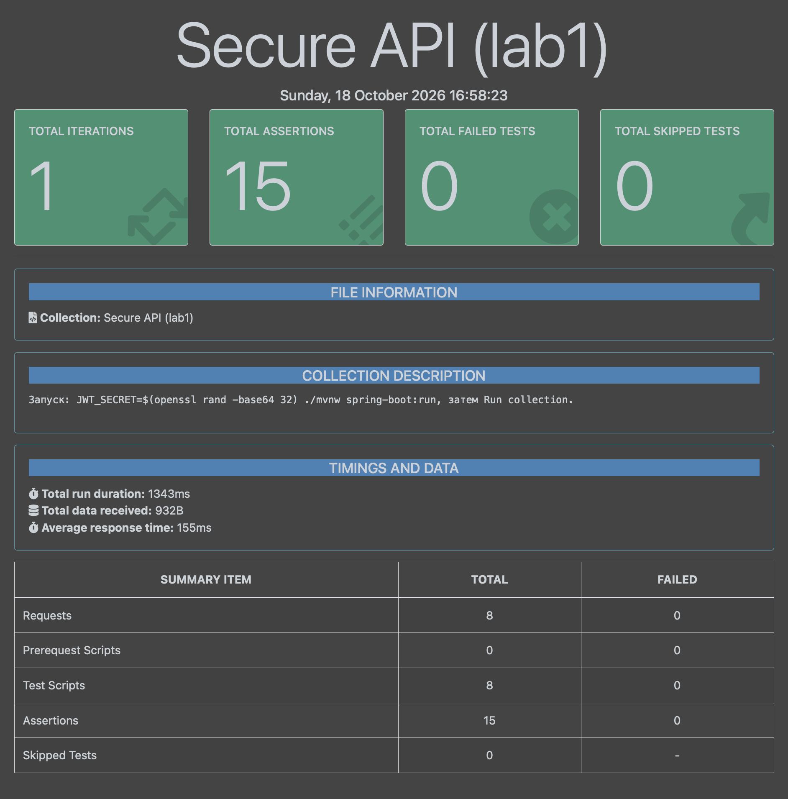
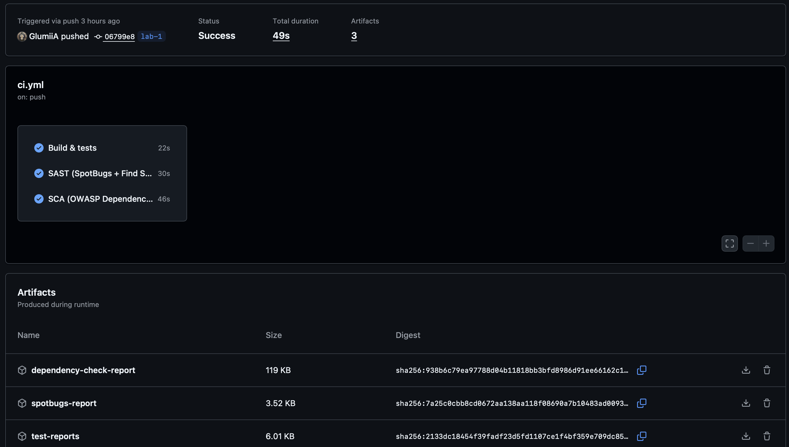
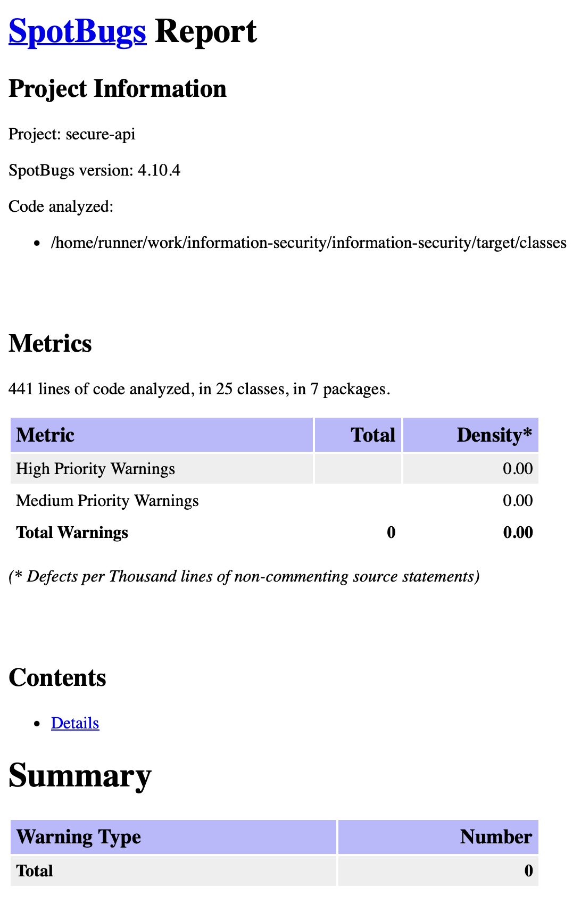

# Лабораторная работа 1. Защищённый REST API

REST API с аутентификацией по JWT и автоматической проверкой безопасности в GitHub Actions.

## Стек

- Java 21, Spring Boot 4.1, Maven
- Spring Security, JJWT — аутентификация
- Spring Data JPA (Hibernate), H2 — база данных
- SpotBugs + Find Security Bugs — SAST
- OWASP Dependency-Check — SCA

## API

| Метод | Путь | Доступ | Описание |
|---|---|---|---|
| POST | `/auth/login` | все | вход по логину и паролю, возвращает JWT |
| GET | `/api/data` | с токеном | список постов |
| POST | `/api/data` | с токеном | создание поста |

Тестовый пользователь: `alice` / `Str0ng-Passw0rd`.

Запуск:
```bash
JWT_SECRET=$(openssl rand -base64 32) ./mvnw spring-boot:run
```

Вход:
```bash
curl -X POST localhost:8080/auth/login -H 'Content-Type: application/json' \
  -d '{"username":"alice","password":"Str0ng-Passw0rd"}'
```
```json
{"accessToken":"eyJhbGciOiJIUzI1NiJ9...","tokenType":"Bearer","expiresIn":900}
```

Получение данных:
```bash
curl localhost:8080/api/data -H "Authorization: Bearer <token>"
```

Создание поста:
```bash
curl -X POST localhost:8080/api/data -H "Authorization: Bearer <token>" \
  -H 'Content-Type: application/json' -d '{"title":"Привет","content":"Первый пост"}'
```

## Меры защиты

### SQL-инъекции

Запросы к базе выполняет Hibernate с именованными параметрами (`where u.username = :username`). Они передаются в базу как Prepared Statements, поэтому ввод пользователя не меняет структуру запроса. Конкатенации строк в SQL нет.

### XSS

Все данные пользователя экранируются перед отправкой ответа встроенной функцией Spring `HtmlUtils.htmlEscape`: `<script>` превращается в `&lt;script&gt;`. Дополнительно в ответах есть заголовок `Content-Security-Policy: default-src 'none'`.

### Аутентификация

- Пароли хранятся только в виде bcrypt-хэша.
- При успешном входе выдаётся JWT, подписанный HMAC-SHA256, со сроком действия 15 минут.
- Фильтр (middleware) проверяет подпись и срок токена на всех запросах к `/api/**`. Без токена или с недействительным токеном возвращается `401 Unauthorized`.
- После 5 неудачных попыток входа логин блокируется на 5 минут.

## CI/CD

Pipeline `.github/workflows/ci.yml` запускается при каждом push и pull request:

1. **Build & tests** — сборка и автотесты.
2. **SAST** — SpotBugs + Find Security Bugs проверяют исходный код.
3. **SCA** — OWASP Dependency-Check проверяет зависимости на известные уязвимости (CVE).

Сборка падает, если найдена уязвимость. Отчёты сохраняются в артефактах запуска.

### Найденные и исправленные уязвимости

| Инструмент | Проблема | Исправление |
|---|---|---|
| SCA | Tomcat 11.0.24: 9 CVE, CVSS до 9.8 | обновлён до 11.0.26 |
| SAST | данные из токена попадали в лог (CRLF-инъекция) | в лог пишется только тип ошибки |
| SAST | возможный XSS в ответе 401/403 | ответ — фиксированный JSON |

## Тестирование

Проверено в Postman (`postman/secure-api.postman_collection.json`): вход работает, без токена доступ запрещён (401), XSS экранируется, SQL-инъекции не срабатывают.



## Отчёты SAST/SCA





## Последний успешный pipeline

https://github.com/GlumiiA/information-security/actions/workflows/ci.yml?query=branch%3Alab-1+is%3Asuccess
